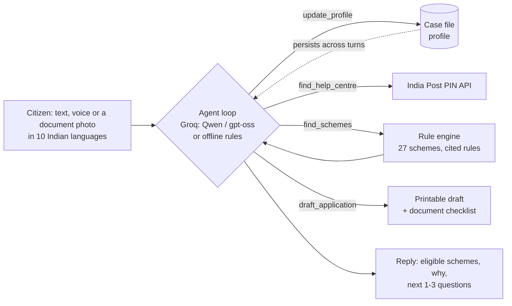

# Yojana Saathi (योजना साथी)

**An AI agent that finds the government schemes a citizen qualifies for, explains why, and gets them ready to apply.**
BharatAgentic Hackathon, powered by aiKart. Track: **Citizen & GovTech**.

[![Deploy with Vercel]https://yojana-saathi-pi.vercel.app/

**At a glance:** 10 Indian languages · text, voice or a document photo · 5-tool agent on Groq's free tier with automatic fallback to offline rules · deterministic eligibility engine over 27 central schemes · printable application drafts · works on phones and laptops · no login, nothing stored.

| What | Where |
|---|---|
| Web app | `/` |
| Agent API (submission Method 2) | `POST /api/agent` (`GET` describes it) |
| Speech-to-text | `POST /api/transcribe` |
| Document reading | `POST /api/document` |
| aiKart sandbox (submission Method 1) | `Dockerfile` + `aikart-manifest.yaml` + `scripts/aikart-run.ts` |

---

## 1. Problem

India runs hundreds of welfare schemes, yet many eligible families never claim them:

- Eligibility rules are scattered across dozens of portals and written in official language.
- People don't know which documents to carry, where to go, or what to say.
- The people who need help most (widows, daily-wage workers, small farmers, first-generation students) are the least able to research it, often in Hindi or a mix of languages.

**Users:** citizens, and the helpers who serve them: CSC operators, ASHA and Anganwadi workers, NGO volunteers and panchayat staff.

## 2. Agentic solution

Yojana Saathi is not a chatbot that recites scheme pages. It is an **agent with tools**:

| Step | What the agent does | Tool |
|---|---|---|
| Understand | Pulls structured facts out of free text in English, Hindi or Hinglish ("52 साल की विधवा, BPL कार्ड, चूल्हे पर खाना") | `update_profile` |
| Locate | Resolves a PIN code to district and state, and lists nearby post offices and the CSC locator | `find_help_centre` (India Post public API) |
| Decide | Runs a **deterministic rule engine** over 27 central schemes. Every verdict cites the exact rule that passed, failed or is unknown | `find_schemes` |
| Plan | Picks the next 1–3 questions that would confirm the most schemes, weighted by how close each scheme is | built into `find_schemes` |
| Act | Produces a printable, pre-filled application helper sheet with documents and steps | `draft_application` |
| Explain | Shows documents, steps, the official link and caveats | `get_scheme_details` |

**Why it is agentic:** the LLM decides which tools to call and in what order, keeps the citizen's case file across turns, asks only the questions that matter, and takes an action (the draft). The LLM never decides eligibility itself: the rule engine does, so answers can't be hallucinated.

## 3. Agent workflow



Every step streams to the UI as a live **agent trace** with real tool inputs, outputs and timings.

**Two engines, one toolset:**
- **Groq mode** (free tier, `GROQ_API_KEY` set): `qwen/qwen3.8-27b` plans and calls the tools and replies in the user's language; on a rate limit it falls through to `openai/gpt-oss-120b`, then `gpt-oss-20b`, then offline rules. A rule-based pre-read puts the facts it is sure of in first, so a fallback model can't drop them.
- **Voice:** Whisper Large v3 on Groq (turbo as retry), language pinned and a domain vocabulary prompt; the transcript lands in the text box for the user to check before sending. Without a key, the browser's own recogniser is used. Measured on 8 synthetic English clips full of scheme names and rupee amounts: **98.2% word accuracy** (113 words, 2 near-misses). Hindi and other Indian languages were not measured (no local test voices); expect lower on noisy phone audio.
- **Documents:** a photo or PDF of a ration card, income / caste / disability certificate or land record is read by Qwen vision into eligibility facts only. Names, Aadhaar, card and phone numbers are never extracted, and any long digit run is scrubbed server-side. Nothing is stored.
- **10 languages:** English, Hindi, Bengali, Marathi, Telugu, Tamil, Gujarati, Kannada, Malayalam, Punjabi. The whole interface is translated, and replies follow the script the user writes in.
- **Offline mode** (no key, or if the LLM fails or hits a rate limit): rule-based understanding with the same tools. The app never goes down mid-demo; failover shows in the trace.

## 4. Impact

- **Time:** finding schemes and documents usually takes several office visits or hours online. Here it takes one conversation of about 2 minutes.
- **Money:** the UI totals the cash support found (₹ per year, plus one-time amounts) and the insurance or health covers unlocked. Example: the rural widow persona finds 5 schemes from her first message (6 after one follow-up), including ₹5 lakh health cover, a widow pension and a free LPG connection.
- **Access:** 10 Indian languages, voice input, document photos instead of typing, large readable type (Atkinson Hyperlegible), works on a ₹6,000 phone and on laptops, and no login.
- **Scale path:** CSC operators and ASHA workers can run it for many citizens a day; the JSON API plugs into WhatsApp or IVR bots.

## 5. Responsible AI

- **No hallucinated eligibility:** verdicts come from coded rules, each with an official source link. Unknown facts give "needs info", never a silent "no".
- **Privacy:** nothing is stored server-side; the case file lives in the browser tab. The agent never asks for Aadhaar, bank numbers or OTPs, and the draft leaves those blank on purpose.
- **Honesty:** every result says to confirm at the office or official site. State top-ups and SECC-list checks are flagged where they apply.
- **Safety:** input validation and a profile whitelist at the API boundary, rate limiting, security headers, and the API key kept server-side only.

**Limits (stated plainly):** covers 27 central schemes, not state schemes; rules are summarised and must be re-verified before production; offline mode understands common phrasing only.

**Path to adoption:** first with CSC operators and ASHA/Anganwadi workers, who already help citizens apply and can run many cases a day; then through WhatsApp or IVR on the same JSON API; then by adding state schemes as data rows (no code changes, since every scheme is just rules in `data/schemes.json`).

## Hackathon requirements checklist

| Requirement (brief) | Where it is met |
|---|---|
| 1. Problem statement: problem, users, why it matters | Section 1 |
| 2. Agentic solution: what makes it agentic | Section 2, plus the live agent trace in the UI |
| 3. Agent workflow: input, reasoning, tools/data, outcome | Section 3 diagram, the trace panel, and "How the agent worked" in every API/sandbox response |
| 4. Impact | Section 4, and the live benefit totals in the UI |
| 5. Working prototype | Web app + API (Method 2) and sandbox container (Method 1) |
| Strong submission: agent, not a chatbot | 5 tools, rule engine, multi-turn case file, takes an action (draft) |
| Strong submission: responsible, secure | Section 5 |
| Strong submission: realistic adoption path | Path to adoption, above |
| Submission Method 1: Dockerfile + YAML manifest | `Dockerfile`, `aikart-manifest.yaml`, `scripts/aikart-run.ts` |
| Submission Method 2: API endpoint | `POST /api/agent` (section 8) |
| Mandatory: Google Form | Done by the team with the deployed URL / image |

## 6. Run locally

Requires Node 20.9+.

```bash
npm install
npm run dev        # http://localhost:3000
npm test           # rule engine + language understanding tests
```

Optional: copy `.env.example` to `.env.local` and add a free Groq key from https://console.groq.com/keys. Without it the app runs in offline mode (no document reading; browser speech only).

## 7. Deploy to Vercel (free Hobby plan)

Fastest: click **Deploy with Vercel** at the top of this README. Or by hand:

1. In Vercel: **Add New → Project → import `bipinjr/Yoajana-Saathi`** (or run `npx vercel` in a clone).
2. Root Directory: leave as the repository root. Framework preset: **Next.js** (auto-detected). Build command, output and Node version need no changes (`engines.node >= 20.9`).
3. The API routes run as Node.js functions with `maxDuration` set in code (60 s agent, 30 s speech and documents), within the Hobby plan.
4. **Settings → Environment Variables:** add `GROQ_API_KEY`. Optional overrides are listed in `.env.example`.
5. Deploy. Your hackathon API endpoint is `https://<your-app>.vercel.app/api/agent`.

## Submit on aiKart

**Method 2: API endpoint (recommended, uses Groq if the key is set).** Submit `https://<your-app>.vercel.app/api/agent`. It accepts `{ "message": "..." }` (also `input`, `query`, `prompt`, `situation`, or a plain-text body), allows cross-origin calls, and returns `{ "format": "markdown", "response": "..." }` plus the full structured result. `GET` on the same URL describes the API.

**Method 1: YAML manifest + Docker ("Try Me Now" sandbox).** The container follows the aiKart Agent Manifest Guide v1 runtime contract: it reads `/aikart/input.json` (or `$AIKART_INPUT`), writes `{ "format": "markdown", "response": ... }` to `/aikart/output.json` and exits 0. It needs no network and no secrets (offline mode), matching the default `networkEgress: none`.

```bash
docker build -t YOUR_DOCKERHUB_USERNAME/yojana-saathi:1.0.0 .
docker run --rm --network none -e AIKART_INPUT='{"situation":"I am a 52 year old widow in a village in Bihar with a BPL card","language":"English"}' -e AIKART_OUTPUT=/tmp/out.json YOUR_DOCKERHUB_USERNAME/yojana-saathi:1.0.0
docker push YOUR_DOCKERHUB_USERNAME/yojana-saathi:1.0.0
```

Then replace `YOUR_DOCKERHUB_USERNAME` in `aikart-manifest.yaml` and upload it in the listing wizard's "Try / Run My Agent" step. Test the contract without Docker: `AIKART_INPUT='{"situation":"..."}' AIKART_OUTPUT=out.json node scripts/aikart-run.ts`.

**Both methods:** finish with the official Google Form linked in the brief.

## 8. API (submission endpoint)

`GET /api/agent` describes the endpoint.

`POST /api/agent`

```json
{
  "message": "I am a 52 year old widow in a village in Bihar with a BPL card",
  "history": [{ "role": "user", "text": "..." }, { "role": "agent", "text": "..." }],
  "profile": {},
  "lang": "en",
  "stream": false
}
```

Only `message` is required (aliases: `input`, `query`, `prompt`, `situation`; optional `pincode`, `language`). Pass back the `profile` from the previous response to continue a case. With `"stream": true` the response is NDJSON events (`trace`, `profile`, `schemes`, `draft`, `reply`, `done`).

Response:

```json
{
  "format": "markdown",
  "response": "# Yojana Saathi: your scheme check\n\n**What I understood:** ...",
  "reply": "What I understood: ... You look eligible for 5 schemes ...",
  "lang": "en",
  "profile": { "age": 52, "gender": "female", "maritalStatus": "widowed", "state": "Bihar", "bpl": true },
  "schemes": [{ "id": "nsap-widow", "verdict": "eligible", "confidence": 1, "benefit": "...", "rules": [{ "label": "Widowed", "outcome": "pass" }], "missing": [], "source": "https://nsap.nic.in" }],
  "trace": [{ "kind": "tool", "tool": "find_schemes", "title": "Checked eligibility rules", "input": {}, "output": {}, "ms": 2 }],
  "followUps": ["What work do you do?"],
  "drafts": {},
  "mode": "groq",
  "model": "qwen/qwen3.8-27b"
}
```

Errors: `400` (no message text), `413` (message over 2,000 characters or body over 20 KB), `429` (over 20 requests a minute per IP), `405` (other methods). CORS is open (`*`); the API uses no cookies or auth.

## 9. Project map

```
app/page.tsx            UI: conversation, case file, live trace, findings, draft dialog
app/api/agent/route.ts  API: validation, CORS, rate limit, JSON or NDJSON streaming
app/i18n.ts             UI strings and example prompts in 10 languages
app/api/transcribe      Speech-to-text (Groq Whisper, turbo retry)
app/api/document        Document photo / PDF page -> eligibility facts (Qwen vision, IDs scrubbed)
lib/agent.ts            Agent: tools, Groq tool-calling loop with model fallback, hybrid pre-read, offline mode, markdown report
lib/http.ts             Shared CORS, JSON and rate limiting for the API routes
lib/engine.ts           Rule engine, profile whitelist, follow-up ranking, draft generator
lib/nlu.ts              Offline EN/HI/Hinglish understanding
data/schemes.json       27 schemes: machine-readable rules, documents, steps, official sources
scripts/aikart-run.ts   aiKart sandbox entry point (Method 1 runtime contract)
Dockerfile              Sandbox image (Node 24, no dependencies)
aikart-manifest.yaml    aiKart Agent Manifest v1
tests/engine.test.ts    17 tests (node --test)
```

## 10. Data sources

Official scheme portals (linked per scheme in `data/schemes.json`), the India Post PIN code API (`api.postalpincode.in`) and the CSC locator. Free and public only. Not affiliated with the Government of India.
